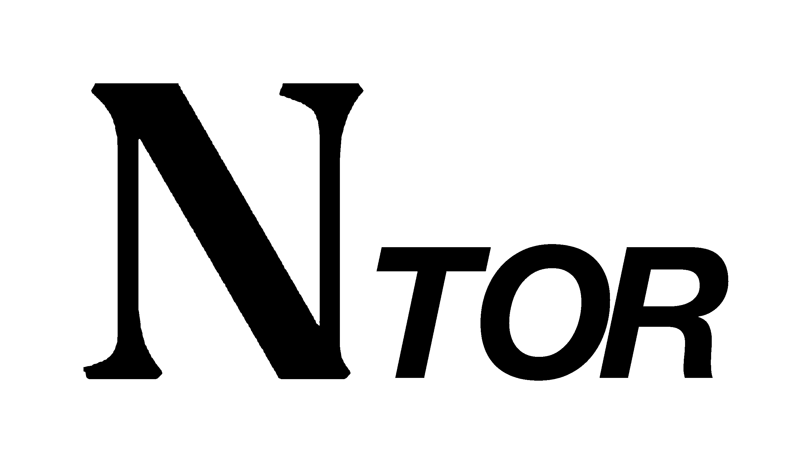

<div align="center">
  
</div>

<h1 align="center">Nostorgraph</h1>

<p align="center"><b>Publication anonyme et décentralisée.</b></p>
<div align="center">
  <a href="https://unlicense.org">
    
  </a>
  <a href="https://github.com/wuddleko/nostorgraph/releases/latest">
    
  </a>
  <a href="https://github.com/wuddleko/nostorgraph/commits/main/">
    
  </a>
  <a href="http://cpvqcbj7effj5d7hquxck2vek2thkhhgi2w3y3776ixbjn3lbvjoufad.onion/">
    
  </a>

[English](README.md) | [简体中文](README.zh.md) | Français

</div>

Un fork de [nonograph](https://github.com/du82/nonograph) par [du82](https://github.com/du82).

Nostorgraph est une plateforme de publication anonyme et simple, pour qui veut mettre ses mots en ligne sans identité, et sans qu'une seule entité détienne ses pensées.

Écris, clique sur STORE, la note est chiffrée, partage le lien. Quelqu'un ouvre le lien, et son navigateur déchiffre la note.

L'instance stocke la note chiffrée sur des [relais nostr](https://nostr.com/info) via Tor. Ainsi un relai voit du texte chiffré issu d'une sortie Tor.

Pas de compte, pas de profil, pas d'analyse qui suit les lecteurs et les auteurs.

<video src="demo/nostorgraph.mp4" width="830" controls></video>

## Instances

| Disponibilité                                                           | Lieu        | Clearnet              | Onion                                                                                   |
|-------------------------------------------------------------------------|-------------|-----------------------|-----------------------------------------------------------------------------------------|
|  | 🇩🇪 Allemagne | https://nostorgra.ph | http://cpvqcbj7effj5d7hquxck2vek2thkhhgi2w3y3776ixbjn3lbvjoufad.onion/ |

Hébergez la vôtre si vous en voulez une autre ([déployer](#déployer)).

## Déployer

```bash
git clone https://github.com/wuddleko/nostorgraph
cd nostorgraph
make up
```

Ouvrez http://localhost:8009. Ce port n'écoute que sur la boucle locale de l'hôte. Placez un reverse proxy devant pour le HTTPS.

`make up` construit l'image et démarre le conteneur `nostorgraph_app`. `make onion` affiche l'adresse onion. Aussi : `make logs`, `make status`, `make down`.

Modifiez `Config.toml` avant `make up` si le port Tor ou la liste des relais doit différer des valeurs par défaut. `[nostr].socks` est le port Tor local. Docker utilise `127.0.0.1:9050`.

L'état reste dans votre répertoire personnel :

- `~/nostorgraph/content` contient des copies facultatives des pages à propos, mentions légales, api et balisage, ainsi que le pool de relais exploré. Les notes publiées n'y sont pas stockées.
- `~/nostorgraph/onion` contient les clés du service caché Tor.
- `~/nostorgraph/tor` contient l'état Tor, y compris le garde d'entrée.

L'image préconstruite est `ghcr.io/wuddleko/nostorgraph:latest`. Sur un système de type Debian, sans Docker, `./scripts/run` compile le binaire et installe un service systemd. Plus de détails : [DOCKER.md](DOCKER.md).

## Nom
`anonymous` + `monograph` + `telegraph` = `nonograph`  

`nonograph` + `tor` + `nostr` = `nostorgraph`

## Licence
Domaine public ([Unlicense](https://unlicense.org)). Ce logiciel appartient à tout le monde. Utilisez-le, modifiez-le, partagez-le sans restriction. Pas d'attribution exigée, pas de conditions cachées, aucune garantie fournie.
