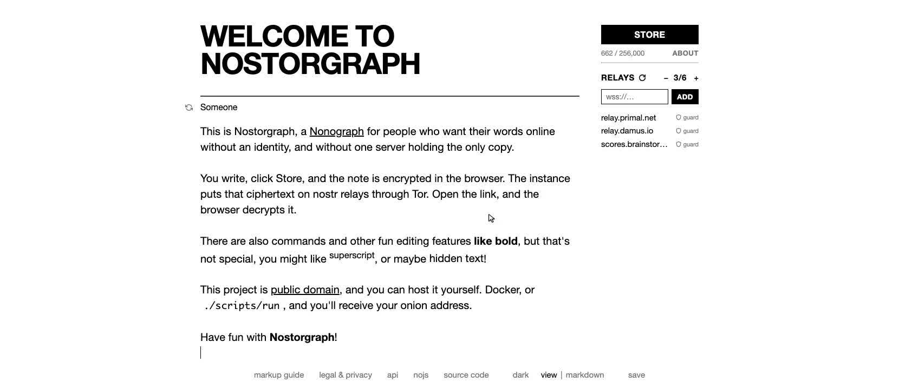

<div align="center">
  
</div>

<h1 align="center">Nostorgraph</h1>

<p align="center"><b>面向重视共同隐私的网络，提供匿名、去中心化的发布。</b></p>
<div align="center">
  <a href="https://unlicense.org">
    
  </a>
  <a href="https://github.com/wuddleko/nostorgraph/releases/latest">
    
  </a>
  <a href="https://github.com/wuddleko/nostorgraph/commits/main/">
    
  </a>
  <a href="http://cpvqcbj7effj5d7hquxck2vek2thkhhgi2w3y3776ixbjn3lbvjoufad.onion/">
    
  </a>

[English](README.md) | 简体中文 | [Français](README.fr.md)

</div>

这是 [du82](https://github.com/du82) 的 [nonograph](https://github.com/du82/nonograph) 的一个分支。

Nostorgraph 是一个简单的匿名发布平台，适合想把文字放到网上、却不想带上身份、也不想让单一实体持有自己想法的人。

你写下内容，点击存储，笔记被加密，你得到一个链接。别人打开这个链接，由他们的浏览器解密。

实例通过 Tor 把加密后的笔记存在 [nostr 中继](https://nostr.com/info)上。因此中继看到的是来自 Tor 出口的密文。

没有账号，没有个人主页，也不会有分析工具跟着读者和作者。

<p align="center">
  <a href="demo/nostorgraph.mp4">
    
  </a>
</p>

## 实例

| 运行状态                                                                | 位置     | 公网                  | Onion                                                                                   |
|-------------------------------------------------------------------------|----------|-----------------------|-----------------------------------------------------------------------------------------|
|  | 🇩🇪 德国 | https://nostorgra.ph | http://cpvqcbj7effj5d7hquxck2vek2thkhhgi2w3y3776ixbjn3lbvjoufad.onion/ |

若要另一套，请自行托管（[部署](#部署)）。

## 部署

```bash
git clone https://github.com/wuddleko/nostorgraph
cd nostorgraph
make up
```

打开 http://localhost:8009。该端口只监听主机的回环地址。生产环境请在前面加反向代理以提供 HTTPS。

`make up` 构建镜像并启动容器 `nostorgraph_app`。`make onion` 打印 onion 地址。另外还有 `make logs`、`make status`、`make down`。

若 Tor 端口或中继列表需要不同于默认值，请在 `make up` 之前编辑 `Config.toml`。`[nostr].socks` 是本地 Tor 端口。Docker 使用 `127.0.0.1:9050`。

状态保存在你的主目录：

- `~/nostorgraph/content` 存放关于、法律、接口、标记四个页面的可选副本，以及爬取到的中继池。已发布的笔记不存在这里。
- `~/nostorgraph/onion` 存放 Tor 隐藏服务密钥。
- `~/nostorgraph/tor` 存放 Tor 状态，包括入口守卫。

预构建镜像是 `ghcr.io/wuddleko/nostorgraph:latest`。在 Debian 系系统上不用 Docker 时，`./scripts/run` 会构建二进制文件并安装一个 systemd 服务。更多说明：[DOCKER.md](DOCKER.md)。

## 名称
`anonymous` + `monograph` + `telegraph` = `nonograph`  

`nonograph` + `tor` + `nostr` = `nostorgraph`

## 许可
公有领域（[Unlicense](https://unlicense.org)）。本软件属于所有人。可使用、修改、分享，不受限制。无需署名，没有附加条件，也不提供任何担保。
